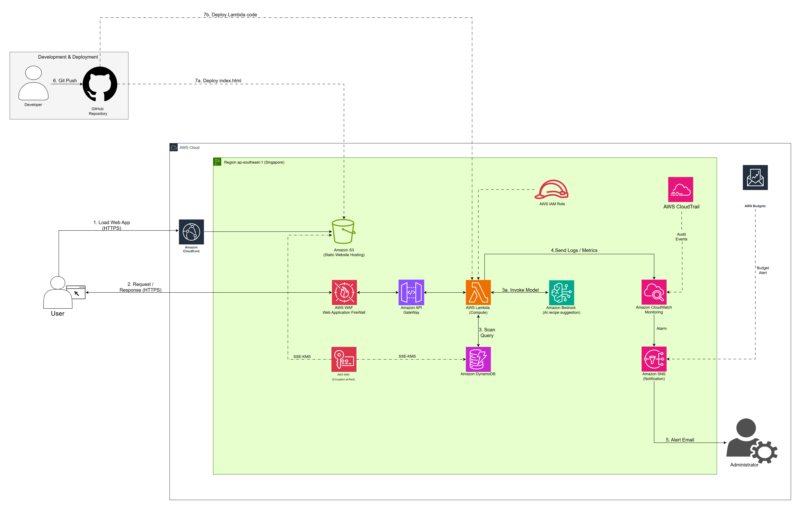
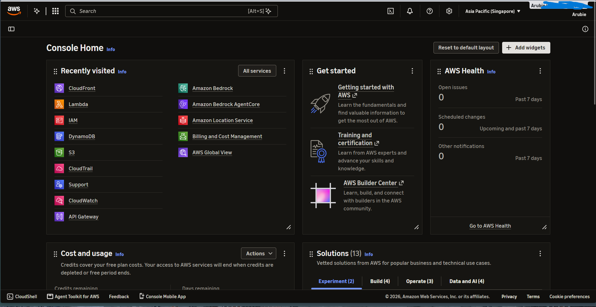

#### System Architecture

The **Bếp Thông Minh (Smart Kitchen)** application separates the static frontend from the business-logic backend to optimize operating costs through a pay-as-you-go model and support automatic scaling:

| Component | AWS Service | Primary Role |
| :--- | :--- | :--- |
| Frontend Hosting | Amazon S3 | Stores the static frontend file (`template.html`) |
| CDN & Security | Amazon CloudFront | Distributes content globally and provides HTTPS for HTML5 Geolocation |
| API Layer | Amazon API Gateway | Provides HTTP endpoints (`GET /search`, `GET /nearby-stores`, `POST /chat`) |
| Compute | AWS Lambda (Python 3.12) | Processes searches and calls Bedrock AI and location services |
| Database | Amazon DynamoDB | Stores recipe data (`RecipesTable`) |
| Generative AI | Amazon Bedrock | Provides recipe suggestions based on mood and weather (`apac.amazon.nova-micro-v1:0`) |
| Geospatial | Amazon Location Service | Geocodes manually entered addresses and finds ingredient retailers (`geo-places` v2) |

#### Project Architecture:

#### Prerequisites
1. An AWS account with permissions to manage **IAM, DynamoDB, Lambda, API Gateway, S3, CloudFront, Bedrock**, and **Amazon Location Service**.
2. Use **Asia Pacific (Singapore) — `ap-southeast-1`** as the deployment Region.
3. Enable access to the **Amazon Nova Micro** model (`apac.amazon.nova-micro-v1:0`) in **Amazon Bedrock → Model access**.

