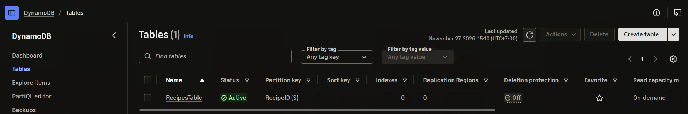
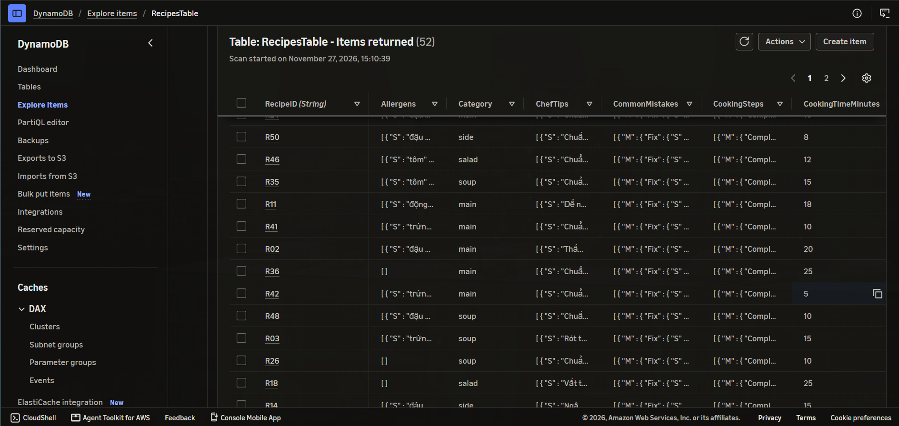

#### Procedure

1. Open the **AWS Management Console**, search for **DynamoDB**, and choose **Create table**.
2. Enter the table configuration:
   * **Table name:** `RecipesTable`
   * **Partition key:** `RecipeID` (Kiểu dữ liệu: `String`)
   * **Table settings:** Select **Default settings** (On-demand capacity mode).
3. Choose **Create table** and wait until the table status changes to **Active**.
4. Open `RecipesTable` → **Explore table items** → **Create item** to add sample data with the following attributes: `RecipeID`, `Name`, `Category`, `Ingredients`, `EstimatedCostVND`, `CookingTimeMinutes`, `MoodTags`, `DietTags`, `CookingSteps`.

