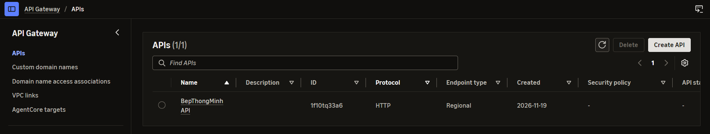
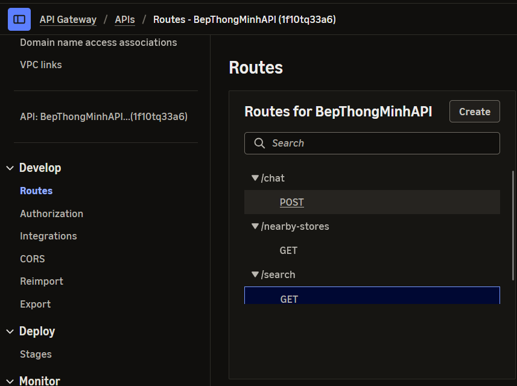
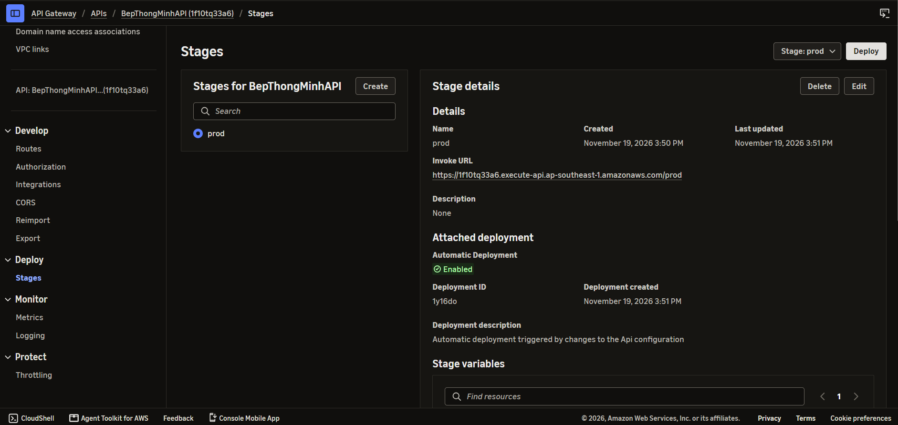
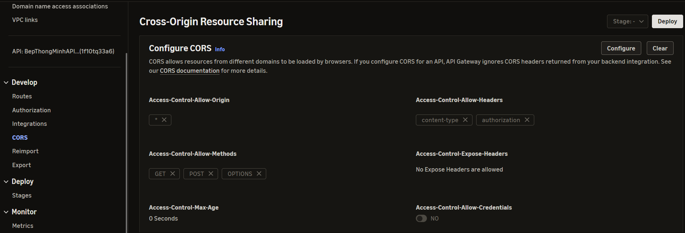

#### Procedure

1. Go to **API Gateway → Create API → HTTP API → Build**.
2. Choose **Add integration** → select **Lambda** → point to `RecipeSearchFunction` and name the API `BepThongMinhAPI`.

3. Create three **routes**, all integrated with `RecipeSearchFunction`:
   * `GET /search`
   * `GET /nearby-stores`
   * `POST /chat`

4. Name the stage `prod` and complete the setup.

5. Open the API's **CORS** section and configure:
   * **Access-Control-Allow-Origin:** `*`
   * **Access-Control-Allow-Methods:** `GET, POST, OPTIONS`
   * **Access-Control-Allow-Headers:** `Content-Type, Authorization`

6. Save the **Invoke URL** (`https://1f10tq33a6.execute-api.ap-southeast-1.amazonaws.com/prod`) and assign it to the `API_BASE` variable in the frontend.
