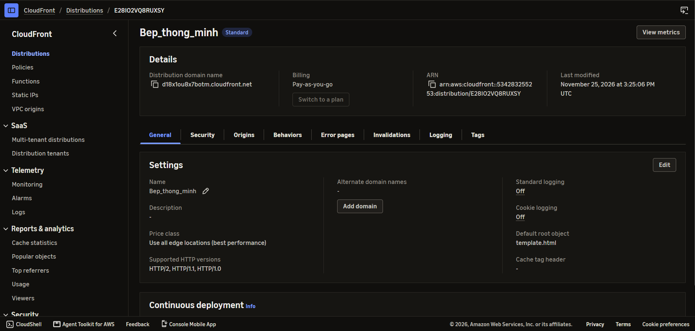

> ****Technical note:**** Modern web browsers block the GPS geolocation API (`navigator.geolocation`) when a website runs over `http://`. Therefore, deploying **Amazon CloudFront** to provide **HTTPS** is required.

#### 1. Configure Amazon S3
  . Create an S3 bucket named `recipe-suggestion-website` and clear **Block all public access**.
  . Add a **bucket policy** that allows public read access:

```json
{
  "Version": "2012-10-17",
  "Statement": [
    {
      "Sid": "PublicReadGetObject",
      "Effect": "Allow",
      "Principal": "*",
      "Action": "s3:GetObject",
      "Resource": "arn:aws:s3:::recipe-suggestion-website/*"
    }
  ]
}
```
  .Enable static website hosting with `template.html` as the index document, then upload `template.html` to the bucket root.

#### 2. Configure Amazon CloudFront
Go to **CloudFront → Create distribution** and set the origin domain to your S3 bucket (leave **Origin path** empty).

  . Under **Viewer protocol policy**, select **Redirect HTTP to HTTPS**.

  . Under **Web Application Firewall (WAF)**, select **Do not enable security protections** to minimize costs.

  . Under **Settings**, set **Default root object** to `template.html`, then choose **Create distribution**.

  . When the status changes to **Deployed**, access the application through `https://<id>.cloudfront.net`.



